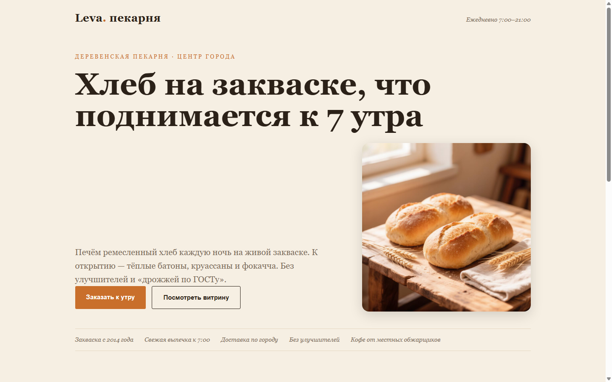
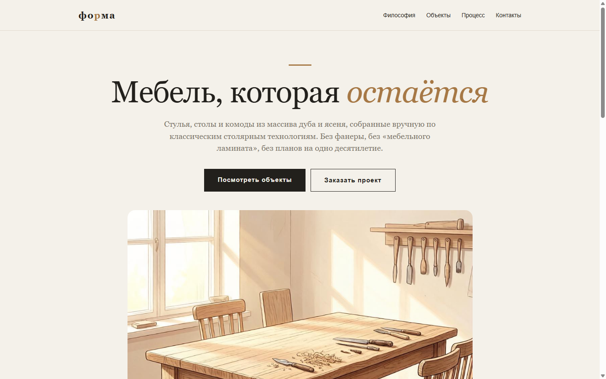
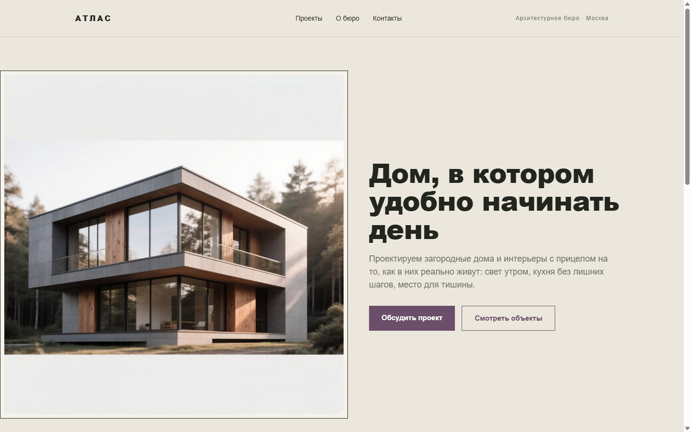

# Landing Pages

Набор продающих лендингов для малого бизнеса. Готовые демо на чистом HTML/CSS
без фреймворков — легко адаптировать под конкретный проект.

## Демо

Страницы опубликованы на GitHub Pages — открываются живыми сайтами:

- [Пекарня](https://nftshich.github.io/landing-pages/пример-01-пекарня.html)
- [Йога](https://nftshich.github.io/landing-pages/пример-02-йога.html)
- [Кофейня](https://nftshich.github.io/landing-pages/пример-03-кофейня.html)
- [Мебель](https://nftshich.github.io/landing-pages/пример-04-мебель.html)
- [Архитектура](https://nftshich.github.io/landing-pages/пример-05-архитектура.html)

## Превью

| | | |
|---|---|---|
|  |  |  |
|  |  | |

## Каталог файлов

- `пример-01-пекарня.html` — пекарня / ремесленный хлеб
- `пример-02-йога.html` — студия йоги
- `пример-03-кофейня.html` — кофейня
- `пример-04-мебель.html` — производство/магазин мебели
- `пример-05-архитектура.html` — архитектурная студия
- `img/` — hero-фотографии
- `preview/` — скриншоты для показа

## Как использовать

1. Скопируйте нужный HTML-файл.
2. Замените тексты, контакты и изображения на свои.
3. Разместите на хостинге или GitHub Pages.

Вёрстка адаптивная, на чистом HTML/CSS — легко редактируется.